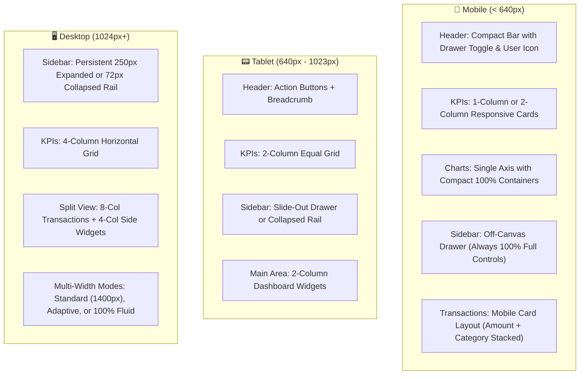

# OwnWallet Design System & Style Specification
*Codename: Fintech Ledger & Precision Craft (Onyx & Tangerine Bronze)*

---

## 1. Executive Philosophy: Eradicating "AI Slop"

Most AI-generated financial dashboards suffer from recognizable visual tropes ("AI Slop"):
- **Low-contrast washed-out text**: Using light gray (`#94a3b8` or 96% lightness `oklch`) on white cards, rendering hints, subtitles, and labels invisible.
- **Generic neon purple/cyan gradients**: Meaningless glows and bloated radial gradients that add noise rather than semantic hierarchy.
- **Puffy, floaty pill buttons**: Excessive border radius (`rounded-full`), blurry drop shadows (`shadow-2xl`), and loose spacing with zero information density.
- **Broken unselected states**: Form inputs and dropdowns that disguise placeholders as active values or hide options entirely when not selected.
- **Pseudo-responsiveness**: Hardcoded desktop column widths that collapse into broken horizontal overflows on mobile devices.

### The OwnWallet Standard: Precision Fintech Ledger
OwnWallet adopts a **tactile, high-density, institutional-grade financial design**:
1. **Legibility First (WCAG AAA/AA)**: Every piece of text, placeholder, hint, and badge has verified contrast (minimum 4.5:1 for hints, 12:1 for body text).
2. **Tabular Numerals**: Every monetary figure uses `tabular-nums` and monospace-like precision alignment.
3. **Structured Micro-Geometry**: Refined 8px–12px radii, razor-sharp 1px structural borders, and subtle elevation changes instead of blurry shadow clouds.
4. **Semantic Color Integrity**: Colors have strict operational meaning (Inflow, Outflow, Debt Obligation, Investment Asset, Target Reserve).
5. **Fluid Responsive Ergonomics**: Components adapt their layout structure—not just shrink—across Mobile (320px–639px), Tablet (640px–1023px), and Desktop (1024px+).

---

## 2. Color Palette & Token Classification

```
┌────────────────────────────────────────────────────────────────────────┐
│                        CORE BRAND ARCHITECTURE                         │
├──────────────────────┬──────────────────────┬──────────────────────────┤
│ Onyx Ink (#090D16)   │ Tangerine Bronze     │ Warm Alabaster (#F8FAFC) │
│ High-contrast ground │ Deep copper accent   │ Clean, glare-free canvas │
└──────────────────────┴──────────────────────┴──────────────────────────┘
```

### 2.1 Core Neutral & Contrast Matrix

| Token | Hex / Value | Light Background Contrast | Role & Usage |
| :--- | :--- | :--- | :--- |
| `--fg` / `--foreground` | `#090D16` (Onyx) | **17.8 : 1** (AAA) | Primary headings, transaction values, active titles |
| `--fg-muted` | `#334155` (Slate 700) | **9.5 : 1** (AAA) | Subtitles, section labels, table column headers |
| `--fg-subtle` / `--hint` | `#475569` (Slate 600) | **6.1 : 1** (AA) | Helper text, form hints, timestamps, inactive icons |
| `--placeholder` | `#64748B` (Slate 500) | **4.6 : 1** (AA) | Form input placeholders (never invisible light gray) |
| `--border-strong` | `#CBD5E1` (Slate 300) | Visual Anchor | Input borders, card dividers, table rows |
| `--border-subtle` | `#E2E8F0` (Slate 200) | Structural Frame | Outer card boundaries, subtle separators |
| `--bg-page` | `#F8FAFC` (Slate 50) | Base Canvas | Page background with warm, non-stark undertone |
| `--bg-card` | `#FFFFFF` | Surface Level 1 | Data cards, modal sheets, dropdown panels |
| `--bg-elevated` | `#F1F5F9` (Slate 100) | Surface Level 2 | Filter pills, table hover states, input backgrounds |

> [!IMPORTANT]
> **Anti-AI-Slop Rule**: Under no circumstances should text be styled with background tokens (`--muted` / `oklch(0.96 ...)`). Muted text MUST always resolve to `--fg-muted` (`#334155`) or `--fg-subtle` (`#475569`).

### 2.2 Semantic Financial Palette

Financial indicators use saturated yet grounded hues, paired with 10%–15% tint backdrops for maximum readability:

| Financial Domain | Primary Hue | Tint Background | Semantic Intent |
| :--- | :--- | :--- | :--- |
| **Thu nhập (Inflow)** | `#047857` (Emerald 700) | `#ECFDF5` (Emerald 50) | Inbound salary, bonus, revenue, debt collection |
| **Chi tiêu (Outflow)** | `#BE123C` (Rose 700) | `#FFF1F2` (Rose 50) | Daily expenses, recurring bills, debt payment |
| **Đầu tư (Invest)** | `#1D4ED8` (Blue 700) | `#EFF6FF` (Blue 50) | Stocks, ETFs, crypto holdings, asset appreciation |
| **Công nợ (Debt/Owe)** | `#B45309` (Amber 700) | `#FFFBEB` (Amber 50) | Pending obligations, loans, receivables |
| **Tiết kiệm (Savings)**| `#6D28D9` (Violet 700) | `#F5F3FF` (Violet 50) | Emergency funds, milestone vaults, rollover goals |
| **Brand Signature** | `#C2410C` (Orange 700) | `#FFEDD5` (Orange 100) | Primary actions, active navigation, logo accent |

### 2.3 Curated Category & Wallet Swatches
To prevent unchosen or invisible colors when users create categories or accounts:
- Preset 10 verified high-contrast swatches:
  `#EA580C` (Tangerine), `#059669` (Emerald), `#2563EB` (Cobalt), `#D97706` (Amber), `#7C3AED` (Purple),
  `#E11D48` (Rose), `#0891B2` (Cyan), `#4F46E5` (Indigo), `#0D9488` (Teal), `#475569` (Slate).
- Selected swatch receives an inset ring (`ring-2 ring-offset-2 ring-primary`) with an inner checkmark.
- Fallback color is always `#EA580C` (Brand Tangerine) with explicit dark text contrast.

---

## 3. Typography & Numerical Precision

### 3.1 Typeface Scale
- **Primary Font**: `Inter`, `-apple-system`, `BlinkMacSystemFont`, sans-serif.
- **Font Features**: `"cv02", "cv03", "cv04", "cv11", "tnum"` (Enables OpenType tabular numbers, open digits, and disambiguated glyphs).
- **Minimum Accessible Size**: `12px` (`text-xs`). Micro-fonts (`text-[9px]`, `text-[10px]`, `text-[11px]`) are strictly forbidden to ensure legibility across all screen densities.

| Token | Size | Line Height | Weight | Usage |
| :--- | :--- | :--- | :--- | :--- |
| `display-xl` | 32px–40px (`text-3xl sm:text-4xl`) | 1.10 | 900 (Black) | Primary KPI values, total net worth |
| `title-xl` | 24px–32px (`text-2xl sm:text-3xl`) | 1.20 | 800 (Extrabold) | Page titles (`h1`, `.page-header-title`) |
| `title-lg` | 18px–20px (`text-lg sm:text-xl`) | 1.25 | 700 (Bold) | Major section headers, card titles |
| `title-md` | 14px–16px (`text-sm sm:text-base`) | 1.35 | 700 (Bold) | Transaction descriptions, widget titles |
| `body-md` | 14px–16px (`text-sm sm:text-base`) | 1.50 | 500/600 | Form inputs, select fields, table cells |
| `body-sm` | 12px–14px (`text-xs sm:text-sm`) | 1.45 | 500 (Medium) | Subtitles, metadata, chart legends, timestamps |
| `caption-bold` | 12px (`text-xs`) | 1.40 | 700 (Bold) | Section dividers, quick presets, badges, STK numbers |

### 3.2 Tabular Numerals Architecture
All numbers (balances, amounts, percentages, quantities, dates) must include `.tabular-nums` (`font-variant-numeric: tabular-nums`). This guarantees that digits align vertically across transaction lists and ledger rows without jitter.

### 3.3 Zero-Duplication & Editorial Clarity Rules
- **No Stacked Duplicate Amounts**: KPI cards must never display the exact same number twice (e.g. compact and full currency right on top of each other). Show ONE prominent, clear figure.
- **No Duplicate Category Titles**: In transaction lists, if a transaction has no custom note, use the category name as title and DO NOT repeat the category name in the subtitle.
- **Single Context Subtitle**: Replace multi-line historical breakdowns in summary cards with a single, clear summary line (`Đầu kỳ: ... · Trong kỳ: ...`).

---

## 4. Component Anatomy & Interactive States

### 4.1 Form Inputs & Dropdowns (Solving "Can't see hint or unchosen color")
```
┌─────────────────────────────────────────────────────────────┐
│ Tên danh mục *                             [Label: #334155] │
├─────────────────────────────────────────────────────────────┤
│ Nhập tên danh mục...                  [Placeholder: #64748B]│
│ [Border: 1px solid #CBD5E1 | Background: #FFFFFF]          │
└─────────────────────────────────────────────────────────────┘
  Hover:   Border #94A3B8
  Focus:   Border #EA580C + 2px Ring rgba(234, 88, 12, 0.15)
  Invalid: Border #E11D48 + 2px Ring rgba(225, 29, 72, 0.15)
```

- **Unselected Dropdown States**:
  - Empty or placeholder option (`value=""`) is explicitly styled in `#64748B` (Slate 500) font.
  - Active chosen options render in bold `#090D16` (Onyx) font.
  - Native `<option>` elements have fixed dark text on light background to prevent OS dark-mode inverted contrast bugs.

### 4.2 Buttons & Controls
- **Primary Button**: Solid Tangerine-Bronze (`#C2410C` to `#EA580C`), 1px subtle top border highlight, white text, 8px radius. Active state scales to `0.98`.
- **Secondary Button**: Solid white surface, 1px `#CBD5E1` border, `#090D16` text. Hover transitions to `#F1F5F9`.
- **Filter Pills**: Inactive state is `#F1F5F9` with `#334155` text (never invisible); active state is high-contrast brand or semantic color.

---

## 5. Responsive Architecture & Grid Specifications



### 5.1 Responsive Breakpoint Rules

| Viewport | Range | Sidebar Behavior | Dashboard Main Page Behavior |
| :--- | :--- | :--- | :--- |
| **Mobile (`xs`/`sm`)** | 320px – 639px | Hidden off-canvas drawer (`z-50`). **Must always render full wallet & time controls** (never collapsed icons). Full height scroll. | 1-col flow. KPI amounts scale cleanly (`text-2xl`). Transactions stack details to prevent horizontal overflow. |
| **Tablet (`md`)** | 640px – 1023px | Off-canvas drawer triggered by header button. Backdrop click and `ESC` to close. | 2-col KPI grid. Charts retain 240px min-height without label collision. |
| **Desktop (`lg`/`xl`/`2xl`)**| 1024px+ | Fixed persistent sidebar. Toggle between 250px expanded and 72px icon rail with shortcuts (`Ctrl+B`). | Full 4-col KPI grid + side-by-side transaction ledger and widgets. |

### 5.2 Sidebar Responsive Fixes
1. **Separation of Mobile State from Desktop Collapse**:
   - `isCollapsed` (stored in `localStorage`) strictly applies to screens `lg:` (1024px+).
   - On screens `< 1024px`, the drawer **always** renders in expanded mode, displaying the full Wallet Selector, full Month/Year Picker, and complete navigation labels.
2. **Scroll Area Containment**:
   - Time filter and wallet selector are compact (`shrink-0`).
   - Nav items are wrapped in a flex-1 `ScrollArea` that scrolls smoothly on phones with short viewport heights (e.g., iPhone SE in landscape or keyboard active).

---

## 6. Implementation Checklist & Verification Matrix

- [x] **Token Harmonization**: Replace all `--muted` mappings with high-contrast Slate tokens (`#334155` for muted foreground, `#64748B` for placeholder/hint).
- [x] **Form Visibility**: Add explicit `placeholder:text-slate-500` and unselected state styles to all `<input>`, `<select>`, and custom selects.
- [x] **Category & Wallet Swatches**: Implement visual color picker palette with active checkmarks and fallback brand colors.
- [x] **Sidebar Desktop/Mobile Separation**: Prevent desktop `isCollapsed` from rendering icon-only buttons on mobile drawers.
- [x] **Dashboard Responsive Reflow**: Apply fluid typography to KPI cards (`text-2xl sm:text-3xl tabular-nums`), responsive chart margins, and resilient transaction row stacking.
- [x] **Zero AI Slop**: Remove any blurry oversized purple/cyan box-shadows, replace with crisp 1px borders and subtle 2px micro-elevations.
